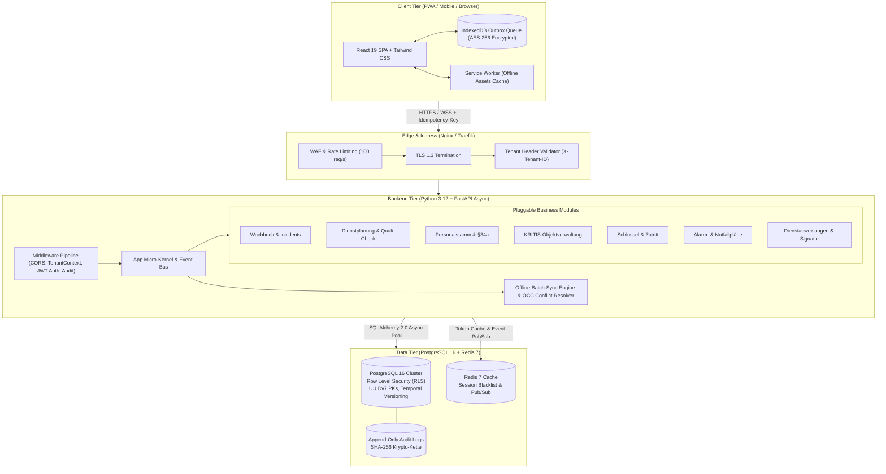

# SECURITYOPS 2.0 – TECHNISCHE ZIELARCHITEKTUR (PHASE 1)

## 1. Systemübersicht & Leitprinzipien
SecurityOps 2.0 ist eine mandantenfähige, hochverfügbare und offline-fähige Enterprise-Verwaltungssoftware für Sicherheitsdienste, Werkschutz, Notruf- und Serviceleitstellen (NSL) sowie KRITIS-Infrastrukturbetreiber gem. **DIN 77200**, **§ 34a GewO / BewachV** und **BSI IT-Grundschutz**.

### Verbindliche Kernanforderungen
1. **Multi-Tenant Isolation**: Strikte Mandantentrennung auf Datenbankebene via PostgreSQL Row-Level Security (RLS) und Connection-Session-Variablen (`app.current_tenant_id`).
2. **Offline-First (Zero Data Loss)**: Operative Kernelemente (Wachbuch, Kontrollgänge, Schichtübergabe, Aufgaben) werden primär im lokalen Client-Storage (IndexedDB / SQLite Wasm) gepuffert und über eine idempotente Replay-Queue synchronisiert.
3. **Modulare Micro-Kernel-Architektur**: Entkoppelte Fachmodule, versionierte REST-Endpunkte (`/api/v1/{module}`), dynamische Registry und Event-Hooks ohne zyklische Abhängigkeiten.
4. **Audit-Sicherheit & Krypto-Integrität**: Jeder Wachbucheintrag und jede Schichtübergabe ist mit einem kryptografischen SHA-256 Hash verkettet (`audit_hash`), um Manipulationssicherheit bei behördlichen Audits zu garantieren.

---

## 2. Gesamtarchitektur & Schichtenmodell

### 2.1 Schichtenübersicht

---

## 3. Datenfluss & Synchronisationspfad
1. **Schreiboperation (Online)**:
   Client -> `POST /api/v1/{module}` (mit JWT Token & `Idempotency-Key`) -> Backend validiert RBAC & Schema -> DB Session setzt Mandantenkontext -> Datensatz committed mit `version=1` -> Audit-Eintrag generiert -> Response 201 Created.
2. **Schreiboperation (Offline / Funkausfall)**:
   Client stellt Netzwerkabbruch fest -> Datensatz wird in `indexedDB.offline_outbox` persistiert -> Lokaler Zustand wird optimistisch auf `pending` gesetzt -> Bei Wiederverbindung sendet Service Worker Batch-Queue an `/api/v1/sync/batch` -> Server prüft Konflikte (`version`) -> Bestätigung & Hash-Abgleich.

---

## 4. Technologie-Entscheidungen (ADR-Übersicht)

| Komponente | Entscheidung | Begründung & DIN 77200 Relevanz |
| :--- | :--- | :--- |
| **Backend** | Python 3.12 + FastAPI | Hohe Performance durch ASGI/uvicorn, native OpenAPI-Dokumentation, typsichere Pydantic v2 Modelle. |
| **ORM** | SQLAlchemy 2.0 (Async) | Explizites SQL-Mapping, volle Unterstützung für PostgreSQL RLS, JSONB und native Prepared Statements. |
| **Migrationen**| Alembic | Revisionssichere, idempotent ausführbare Migrationsschritte mit Modul-Branching. |
| **Datenbank** | PostgreSQL 16 | Industriestandard für relationale Daten, robuste RLS, Transaktionssicherheit (ACID), PG-Crypto und UUIDs. |
| **Frontend** | React 19 + Tailwind CSS | Reaktionsschnelle SPA, barrierefreies UI, responsiv auf Handhelds/Wach-Smartphones, Offline Service Worker. |
| **Cache/Queue**| Redis 7 + Celery / RQ | Schneller Cache für Session-Tokens, Background-Jobs für E-Mail-Eskalation und PDF-Audit-Exporte. |
| **Deployment**| Docker & Docker Compose | Reproduzierbare Container-Infrastruktur, trennbare Stacks je Umfeld (Dev, Staging, Prod). |
