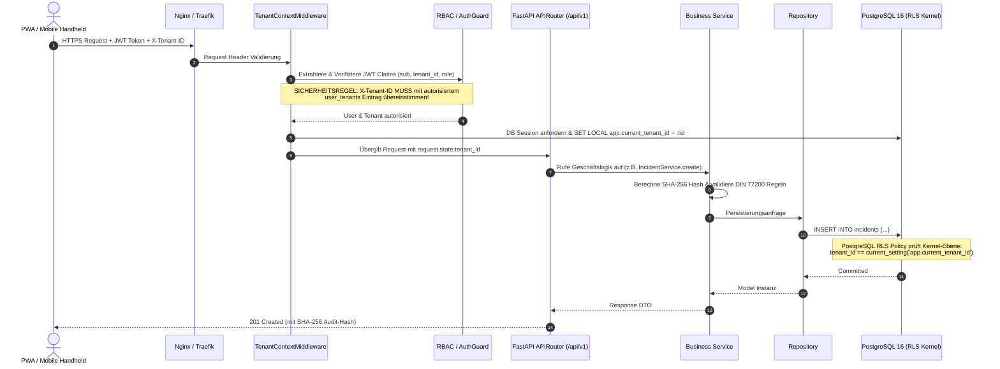

# SECURITYOPS 2.0 – BACKEND-ARCHITEKTUR & SCHICHTENMODELL (PHASE 3)

## 1. Übersicht & Architekturprinzipien
Das Backend von SecurityOps 2.0 ist als modularer, asynchroner Enterprise-Kern auf Basis von **Python 3.12**, **FastAPI** und **SQLAlchemy 2.0 Async** konzipiert. Es setzt das **Clean Architecture / Hexagonal Architecture** Prinzip um:

```
+---------------------------------------------------------------------------------+
|                               API LAYER (FastAPI)                               |
|  - Versionierte Router: /api/v1/{module}                                        |
|  - Dependency Injection (get_current_user, get_tenant_context, get_db)          |
|  - Pydantic v2 Request/Response Validation & OpenAPI Schemas                   |
+----------------------------------------+----------------------------------------+
                                         | DTOs / Schemas
+----------------------------------------v----------------------------------------+
|                          SERVICE LAYER (Geschäftsregeln)                        |
|  - AuthService (Argon2id, JWT Rotation, Brute-Force Tracker)                    |
|  - TenantService (Mandantenisolierung, RLS Kontext-Injektion)                  |
|  - IncidentService (DIN 77200 SHA-256 Krypto-Kette & Revisionssicherheit)       |
|  - ScheduleService (§ 34a GewO Qualifikationsradar & Konflikterkennung)         |
|  - SyncService (Idempotente Batch-Replikation & OCC Konfliktresolution)         |
|  - BackgroundWorker (Ablauffristen, Eskalationen, Benachrichtigungen)           |
+----------------------------------------+----------------------------------------+
                                         | Domain Objects
+----------------------------------------v----------------------------------------+
|                       REPOSITORY LAYER (Datenzugriff)                           |
|  - Generische & fachliche Repositories mit SQLAlchemy 2.0 Async Selects         |
|  - Durchsetzung von 'tenant_id' Filter & Composite Foreign Keys                 |
+----------------------------------------+----------------------------------------+
                                         | Session ('SET LOCAL app.current_tenant_id')
+----------------------------------------v----------------------------------------+
|                        DATA TIER (PostgreSQL 16 + Redis 7)                      |
|  - Kernel Row Level Security (RLS)                                              |
|  - Redis Cache & Token Revocation Blacklist                                    |
+---------------------------------------------------------------------------------+
```

---

## 2. Request Lifecycle & Mandanten-Sicherheitskette



---

## 3. Modulverzeichnis & Namenskonventionen
Die Backend-Codebasis ist unter `backend/app/` in klare funktionale Verzeichnisse gegliedert:
- `core/`: Konfiguration (`config.py`), Sicherheit & Token (`security.py`), RLS Middleware (`middleware.py`).
- `database/`: SQLAlchemy Async Engine, Session-Factory, Base Model.
- `schemas/`: Pydantic v2 Request- & Response-Modelle mit strikter Validierung.
- `services/`: Wiederverwendbare Geschäftslogik ohne direkte HTTP-Abhängigkeit.
- `api/v1/`: Versionierte FastAPI Router für alle 13 Modulgruppen A bis M.
- `background/`: Asynchrone Hintergrundüberwachung von Fristen und Eskalationen.
- `tests/`: Automatisierte Pytest Testsuite.
