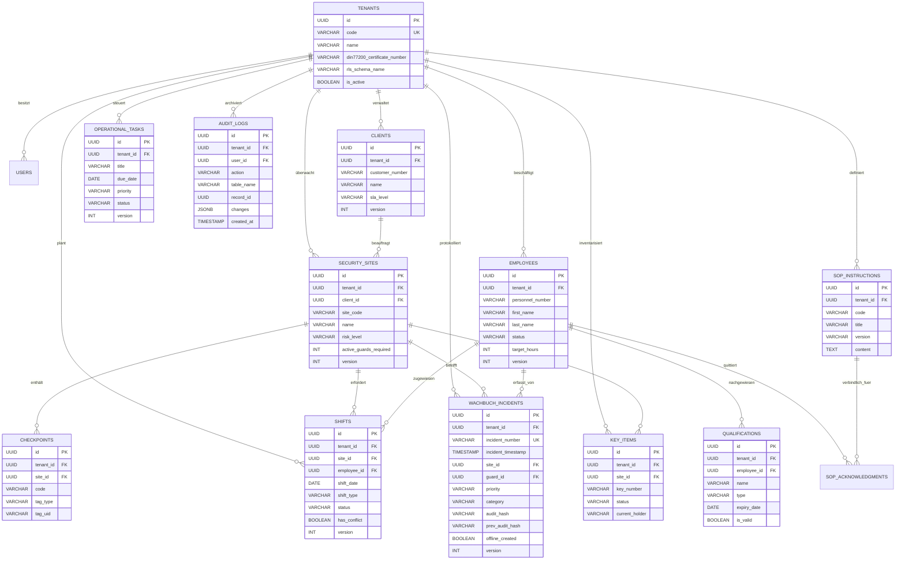

# SECURITYOPS 2.0 – DATENBANKDESIGN & SCHEMA-SPEZIFIKATION (PHASE 1)

## 1. Überblick & Normalisierung
Das Datenbanksystem basiert auf **PostgreSQL 16**. Alle Tabellen befinden sich mindestens in der **3. Normalform (3NF)**.
Für mandantenfähige und offline-synchronisierbare Entitäten gilt verbindlich:
- **Eindeutige Primärschlüssel**: `UUID PRIMARY KEY DEFAULT gen_random_uuid()` (oder UUIDv7 für zeitlich geordnete Indizes)
- **Mandantenbindung**: Jede Fachdatentabelle enthält `tenant_id UUID NOT NULL REFERENCES tenants(id) ON DELETE RESTRICT`
- **Optimistic Concurrency Control**: `version INT NOT NULL DEFAULT 1`
- **Revisions-Zeitstempel**: `created_at TIMESTAMP WITH TIME ZONE DEFAULT CURRENT_TIMESTAMP`, `updated_at TIMESTAMP WITH TIME ZONE DEFAULT CURRENT_TIMESTAMP`
- **Soft-Delete Flag**: `deleted_at TIMESTAMP WITH TIME ZONE NULL` (DSGVO- und Audit-konform)

---

## 2. Vollständiges ER-Diagramm (Entity Relationship)



---

## 3. Relationales Schema (Auszug Kern-DDL)

```sql
-- Extensions
CREATE EXTENSION IF NOT EXISTS "pgcrypto";
CREATE EXTENSION IF NOT EXISTS "uuid-ossp";

-- ============================================================================
-- 1. MANDANTENTABELLE
-- ============================================================================
CREATE TABLE tenants (
    id UUID PRIMARY KEY DEFAULT gen_random_uuid(),
    code VARCHAR(32) UNIQUE NOT NULL,
    name VARCHAR(255) NOT NULL,
    company_registration_number VARCHAR(128) NOT NULL,
    address TEXT NOT NULL,
    primary_contact VARCHAR(128) NOT NULL,
    email VARCHAR(255) NOT NULL,
    phone VARCHAR(64) NOT NULL,
    din77200_certificate_number VARCHAR(128) NOT NULL,
    license_level VARCHAR(64) NOT NULL DEFAULT 'Enterprise Tier 1',
    data_storage_region VARCHAR(64) NOT NULL DEFAULT 'eu-central-1',
    rls_schema_name VARCHAR(64) NOT NULL,
    is_active BOOLEAN NOT NULL DEFAULT TRUE,
    created_at TIMESTAMP WITH TIME ZONE NOT NULL DEFAULT CURRENT_TIMESTAMP,
    updated_at TIMESTAMP WITH TIME ZONE NOT NULL DEFAULT CURRENT_TIMESTAMP
);

-- ============================================================================
-- 2. REVISIONSSICHERES DIGITALES WACHBUCH (DIN 77200)
-- ============================================================================
CREATE TABLE wachbuch_incidents (
    id UUID PRIMARY KEY DEFAULT gen_random_uuid(),
    tenant_id UUID NOT NULL REFERENCES tenants(id) ON DELETE RESTRICT,
    incident_number VARCHAR(64) NOT NULL,
    incident_timestamp TIMESTAMP WITH TIME ZONE NOT NULL DEFAULT CURRENT_TIMESTAMP,
    site_id UUID NOT NULL REFERENCES security_sites(id) ON DELETE RESTRICT,
    guard_id UUID NULL REFERENCES employees(id) ON DELETE SET NULL,
    guard_name VARCHAR(128) NOT NULL,
    category VARCHAR(64) NOT NULL,
    priority VARCHAR(32) NOT NULL,
    title VARCHAR(255) NOT NULL,
    description TEXT NOT NULL,
    actions_taken TEXT NOT NULL,
    police_involved BOOLEAN NOT NULL DEFAULT FALSE,
    resolved BOOLEAN NOT NULL DEFAULT FALSE,
    images_count INT NOT NULL DEFAULT 0,
    escalation_status VARCHAR(32) NOT NULL DEFAULT 'In Bearbeitung',
    offline_created BOOLEAN NOT NULL DEFAULT FALSE,
    audit_hash VARCHAR(128) NOT NULL, -- SHA-256 über Datensatz zur Revisionssicherheit
    prev_audit_hash VARCHAR(128) NULL, -- Blockchain-ähnliche Verkettung nach DIN 77200
    version INT NOT NULL DEFAULT 1,
    created_at TIMESTAMP WITH TIME ZONE NOT NULL DEFAULT CURRENT_TIMESTAMP,
    updated_at TIMESTAMP WITH TIME ZONE NOT NULL DEFAULT CURRENT_TIMESTAMP,
    CONSTRAINT uq_tenant_incident_number UNIQUE (tenant_id, incident_number)
);

-- Performance & Isolation Indices
CREATE INDEX idx_clients_tenant ON clients(tenant_id);
CREATE INDEX idx_sites_tenant ON security_sites(tenant_id);
CREATE INDEX idx_employees_tenant ON employees(tenant_id);
CREATE INDEX idx_shifts_tenant_date ON shifts(tenant_id, shift_date);
CREATE INDEX idx_incidents_tenant_time ON wachbuch_incidents(tenant_id, incident_timestamp DESC);
CREATE INDEX idx_audit_tenant_time ON audit_logs(tenant_id, created_at DESC);
```
