# SECURITYOPS 2.0 – ENTWICKLUNGS-ROADMAP & QA-MATRIX (PHASE 1)

## 1. CI/CD Pipeline & Testautomatisierung

```mermaid
flowchart LR
    Push([Git Push / PR]) --> Lint[Black, Flake8 & ESLint]
    Lint --> TypeCheck[Mypy & TypeScript Check]
    TypeCheck --> UnitTests[pytest: Unit- & Pydantic-Tests]
    UnitTests --> RlsTest[RLS-Multi-Tenant Isolationstest]
    RlsTest --> OfflineTest[Offline Sync & Replay Simulation]
    OfflineTest --> BuildDocker[Docker Compose Build: API & Web]
    BuildDocker --> StagingDeploy([Deploy Staging / E2E Tests])
```

---

## 2. Phasenplan zur Produktionsreife

| Phase | Bezeichnung | Kernliefergegenstände | Status |
| :--- | :--- | :--- | :--- |
| **Phase 1** | **Technische Gesamtarchitektur** | Gesamtarchitektur, DDL Schema, Multitenancy, Offline-Sync, Modulvertrag, Sicherheitskonzept, Roadmap | **ABGESCHLOSSEN (Wartet auf Freigabe)** |
| **Phase 2** | **Grundsystem & RLS-Kern** | FastAPI Projektstruktur, Alembic Migrationen, PostgreSQL RLS Engine, JWT Auth, RBAC Matrix | Bereit nach Freigabe |
| **Phase 3** | **Kernmodule** | Kundenstamm, KRITIS-Objekte, Personalstamm § 34a, Dienstplan-Dispo, Digitales Wachbuch | Geplant |
| **Phase 4** | **Erweiterte Module** | QM & Dienstanweisungen mit Signatur, Schlüsselverwaltung, Alarmpläne, Berichte & CSV/PDF | Geplant |
| **Phase 5** | **Frontend & Offline Engine** | Responsive Leitstand-Oberfläche, Service Worker, IndexedDB Outbox Queue, Gemini KI-Copilot | Geplant |
| **Phase 6** | **Qualitätssicherung & Tests** | Unit-, Integration- und RLS-Isolationstests via pytest, Lasttests, Offline-Sync Stresstests | Geplant |
| **Phase 7** | **Deployment & Release** | Docker Compose Production Stack, Nginx TLS Konfiguration, Backup-Skripte, GitHub Repository | Geplant |

---

## 3. Verbindliche Abschlussprüfung (Phase 1 Checkliste)

| Nr. | Kriterium | Technische Bewertung | Status |
| :--- | :--- | :--- | :---: |
| 1 | **Echte Mandantentrennung** | Durchgesetzt auf PostgreSQL Kernel-Ebene via Row Level Security (RLS) und Connection Session-Variablen. | **ERFÜLLT** |
| 2 | **Offline-Betrieb realistisch** | Lokale Pufferung in IndexedDB mit Idempotency-Keys und SHA-256 Hashes. | **ERFÜLLT** |
| 3 | **Synchronisationskonflikte** | Optimistic Concurrency Control (OCC) mit Temporal Versionsspalte und Append-Merge für Wachbucheinträge. | **ERFÜLLT** |
| 4 | **Modulare Erweiterbarkeit** | Entkoppelte Modulverträge (`SecurityOpsModuleInterface`), versionierte APIs (`/api/v1/*`), keine zyklischen Abhängigkeiten. | **ERFÜLLT** |
| 5 | **Vollständiges Datenbankmodell**| DDL-Spezifikation für alle 10 Kernmodule inkl. Primär-/Fremdschlüssel, Constraints, RLS-Policies und Indizes. | **ERFÜLLT** |
| 6 | **Sicherheitsrisiken berücksichtigt** | BSI IT-Grundschutz, Argon2id Password Hashing, JWT mit Refresh Rotation, Krypto-Auditkette nach DIN 77200. | **ERFÜLLT** |
| 7 | **Produktionstauglichkeit** | Vollständiges Docker Compose Setup, Alembic-Migrationsstrategie und Nginx TLS 1.3 Ingress. | **ERFÜLLT** |
