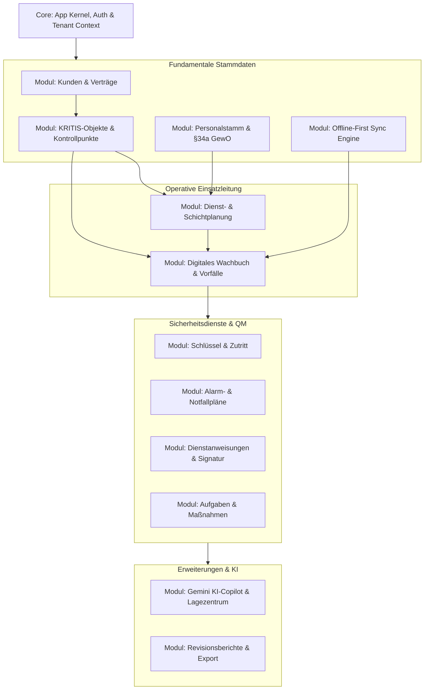

# SECURITYOPS 2.0 – MODULARE SOFTWAREARCHITEKTUR (PHASE 1)

## 1. Modulare Gliederung & Abhängigkeitsgraph (DAG)



---

## 2. Modul-Interface & Lifecycle-Vertrag

Jedes Fachmodul implementiert das standardisierte Python Interface:

```python
# backend/app/core/base_module.py
from abc import ABC, abstractmethod
from fastapi import FastAPI

class SecurityOpsModuleInterface(ABC):
    @property
    @abstractmethod
    def module_id(self) -> str:
        """Eindeutige Modul-ID, z.B. 'mod-wachbuch'"""
        pass

    @property
    @abstractmethod
    def version(self) -> str:
        """SemVer Version des Moduls"""
        pass

    @abstractmethod
    def register_routes(self, app: FastAPI) -> None:
        """Registriert Modul-Router unter /api/v1/{module}"""
        pass

    @abstractmethod
    def register_events(self, event_bus) -> None:
        """Abonniert globale Systemereignisse"""
        pass
```
