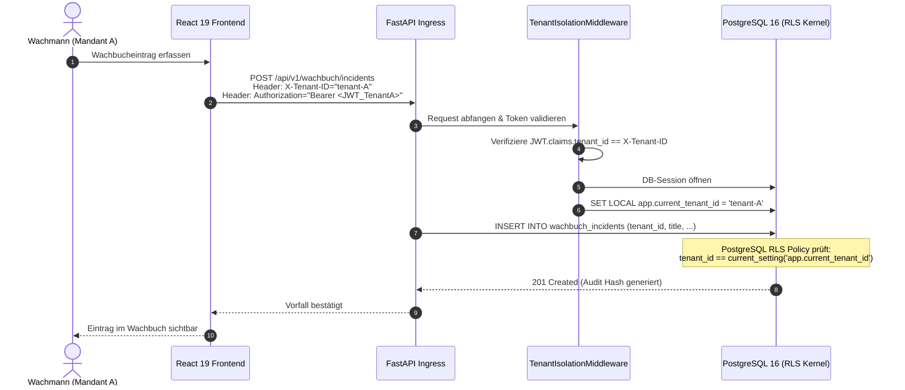

# SECURITYOPS 2.0 – MANDANTENFÄHIGKEIT (MULTITENANCY.MD)

## 1. Mandantenarchitektur & Trennungsebenen
In SecurityOps 2.0 ist Mandantenfähigkeit **keine nachträgliche Abfragefilterung**, sondern tief im Datenbank- und Backend-Kern verankert.

### Architekturmodell: Shared Database, Shared Process, Isolated RLS
- **Gemeinsame PostgreSQL-Datenbank**: Höchste Ressourceneffizienz und einfaches Migrationsmanagement über Alembic.
- **Row-Level Security (RLS)**: PostgreSQL garantiert über Kernel-Policies, dass keine Abfrage fremde Mandantendaten lesen oder schreiben kann.
- **Isolierter Datenspeicher für Dokumente**: Kundenspezifische Verzeichnisse `/var/data/tenants/{tenant_id}/docs/` mit individueller symmetrischer AES-256 Verschlüsselung.

---

## 2. Multi-Tenant Interaktionsfluss (Sequence Diagram)



---

## 3. Row Level Security (RLS) Durchsetzung

### SQL Policy Definition
```sql
-- RLS aktivieren für alle operativen Tabellen
ALTER TABLE clients ENABLE ROW LEVEL SECURITY;
ALTER TABLE security_sites ENABLE ROW LEVEL SECURITY;
ALTER TABLE employees ENABLE ROW LEVEL SECURITY;
ALTER TABLE shifts ENABLE ROW LEVEL SECURITY;
ALTER TABLE wachbuch_incidents ENABLE ROW LEVEL SECURITY;
ALTER TABLE sop_instructions ENABLE ROW LEVEL SECURITY;
ALTER TABLE key_items ENABLE ROW LEVEL SECURITY;
ALTER TABLE operational_tasks ENABLE ROW LEVEL SECURITY;

-- Mandanten-Policy für Lese- und Schreibzugriff
CREATE POLICY tenant_isolation_policy ON clients
    FOR ALL
    USING (tenant_id = NULLIF(current_setting('app.current_tenant_id', true), '')::UUID)
    WITH CHECK (tenant_id = NULLIF(current_setting('app.current_tenant_id', true), '')::UUID);

CREATE POLICY tenant_isolation_wachbuch ON wachbuch_incidents
    FOR ALL
    USING (tenant_id = NULLIF(current_setting('app.current_tenant_id', true), '')::UUID)
    WITH CHECK (tenant_id = NULLIF(current_setting('app.current_tenant_id', true), '')::UUID);
```

---

## 4. Mandantenspezifische Backups & Wiederherstellung
- **Automatisierte logische Dumps**:
  `pg_dump -h db -U secops -d securityops2 -t "*.*" --data-only --where="tenant_id='{tenant_id}'" > backup_{tenant_code}_{timestamp}.sql`
- **DSGVO "Recht auf Löschung / Datenportabilität"**:
  Ein einzelner Mandant kann per Skript vollständig exportiert oder restlos aus der Datenbank entfernt werden, ohne andere Sicherheitsunternehmen zu beeinträchtigen.
