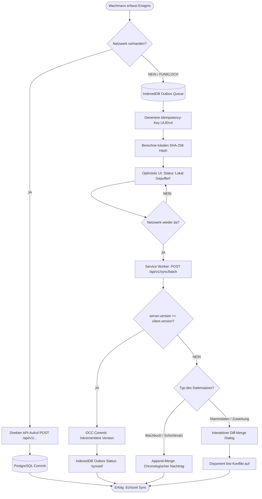

# SECURITYOPS 2.0 – OFFLINE-FIRST ARCHITEKTUR & SYNCHRONISATIONSKONZEPT

## 1. Problemstellung im Sicherheitsdienst
Wachhabende und Interventionskräfte patrouillieren regelmäßig in **Tiefgaragen, Serverbunkern, Rechenzentren (Faradayscher Käfig) oder weitläufigen Industriearealen ohne Mobilfunkempfang**.
Ein Systemausfall oder Ladefehler bei Vorkommnissen gefährdet Leib, Leben und Sachwerte.

---

## 2. Offline-First Replikations- & Synchronisationsfluss



---

## 3. Lokale Datenspeicherung (Client IndexedDB Schema)

SecurityOps 2.0 verwendet im Browser und auf mobilen Endgeräten eine verschlüsselte **IndexedDB** Struktur mit drei Kern-Stores:

```
[Browser IndexedDB: SecurityOpsLocalDB]
  |-- Store: "offline_outbox"          -> [IdempotencyKey, EntityType, Action, Payload, Timestamp, Retries]
  |-- Store: "entity_cache"            -> [UUID, EntityType, Version, Payload, LastUpdated]
  |-- Store: "sync_checkpoints"        -> [TenantID, EntityType, LastSyncedServerTimestamp]
```

---

## 4. Konfliktmatrix (Optimistic Concurrency Control)

| Szenario | Server Zustand | Client Payload | Auflösungsstrategie |
| :--- | :--- | :--- | :--- |
| **Neuer Wachbucheintrag** | Nicht vorhanden | `action: CREATE` | **Server Commit**: Datensatz wird mit `version=1` gespeichert und Krypto-Hash verifiziert. |
| **Gleichzeitige Änderung (gleiche Version)**| `version = client.version` | `action: UPDATE` | **Server Commit**: Aktualisierung wird übernommen, `version` wird inkrementiert. |
| **Versionskonflikt (Stale Update)** | `server.version > client.version` | `action: UPDATE` | **Konflikt-Erkennung**: Server sendet `409 Conflict` zurück mit `server_payload`. Der Client wechselt in den interaktiven Diff-Merge-Modus. |
| **Schichtübergabe-Konflikt** | Schichtleiter gewechselt | Offline Schichtnotiz | **Append-Merge**: Notizen werden als chronologische Nachträge angehängt. Keine Datenlöschung! |
